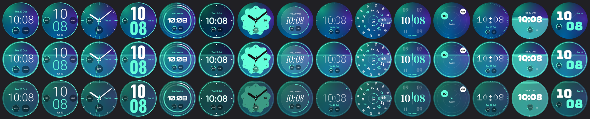
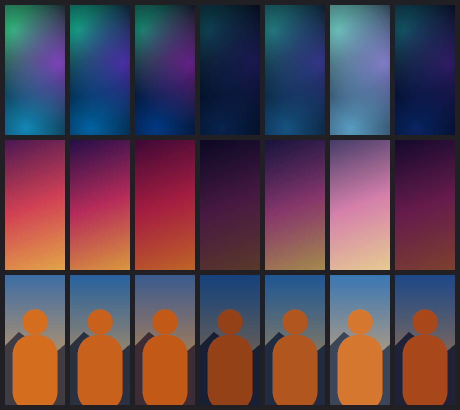

# SyncTheme — обои, виджеты и циферблат часов в одном стиле

Приложение для телефона на Android и часов на Wear OS (делалось для **Galaxy S25+** и **Galaxy Watch 7**, но подходят и другие): выбираете или создаёте тему на телефоне и одной кнопкой «Применить» получаете:

- **обои** рабочего стола и экрана блокировки (градиенты «Аврора», «Сияние», однотонный фон или ваше фото);
- **виджеты**: часы, календарь, погода, батарея и папка приложений — в пяти стилях и в цветах темы. Чем больше виджет, тем больше он показывает;
- **циферблат на часах** в том же стиле. Он автоматически собирается на телефоне и ставится на часы через официальный механизм Wear OS 6 (Watch Face Push), а на часах с Wear OS 3–5 его рисует само приложение SyncTheme.


 

## Что умеет

| | |
|---|---|
| 8 готовых тем | Аврора, Закат, Океан, Графит, Неон, Лес, Сакура, Минимал |
| Своя тема | тип фона, до 4 цветов градиента, угол, затемнение, цвет цифр и акцента |
| Обои из галереи | выбираете фото, и под его цвета подстраиваются цифры, виджеты и циферблат |
| Экран блокировки | те же обои или отдельные (свой фон, фото, затемнение) |
| Виджеты | Часы (10 стилей, включая 4 стрелочных, и 17 шрифтов цифр), Календарь, Погода, Батарея (по 5 стилей) и Приложения (6 стилей). Размер от 1×1 до 4×4 — содержимое подстраивается. Нажатие открывает нужное приложение |
| Циферблат | 15 стилей, из них 12 «живых»: «Барабан», «Колонки», «Планеты», «Матрица», «Заливка», «Диагональ», «Крупно», «Орбита», «Неон», «Облако», «Стекло», «Минимал». 17 шрифтов цифр. По умолчанию повторяет телефон; можно настроить отдельно |
| «Мои темы» | сохраняйте и переключайте собственные темы |
| Оформление приложения | «Стекло», «Экспрессив» или «Неон»; светлое, тёмное или как в системе. Акцент всегда берётся из обоев |
| Эффект глубины | главный объект фото (человек, питомец, гора) встаёт поверх цифр — на циферблате и в «Часах на обоях» |
| Часы на обоях | живые обои SyncTheme: крупные часы прямо на обоях рабочего стола (вверху, столбиком или по центру) |
| Живые данные | шаги наполняют циферблат «водой», кольцо вспыхивает в такт пульсу, при низком заряде гаснет свечение |
| «Хамелеон» | тема сама меняется по времени суток и погоде: обои, виджеты и циферблат |
| «В тон вещи» | снимок ремешка, кофты или кроссовок → тема в этом цвете |
| Другие устройства | любые Android-телефоны, часы на Wear OS 3–6; картинки для iPhone, iPad, Mac, Apple Watch и фото-циферблатов других часов |




## Требования

- Телефон на Android 12 или новее — Samsung, Pixel, Xiaomi, OnePlus и другие. Galaxy S25+ подходит.
- Часы на Wear OS, подключённые к телефону (через Galaxy Wearable, Pixel Watch или Wear OS):
  - **Wear OS 6 и новее** (Galaxy Watch 4 и новее с One UI 8 Watch, Pixel Watch 2 и новее и др.) — циферблат ставится сам через Watch Face Push, работают все функции. Проверить версию на Galaxy Watch: Galaxy Wearable → «Настройки часов» → «О часах» → «Обновление ПО».
  - **Wear OS 3–5** на часах, вышедших до 2024 года (Galaxy Watch 4–6 без обновления, Pixel Watch 1, TicWatch, Fossil и др.) — тему рисует классический циферблат SyncTheme: выберите его один раз в списке циферблатов. Шаги и пульс на нём не показываются, заряд — да.
  - Часы, которые вышли сразу с Wear OS 5 (Galaxy Watch 7, Pixel Watch 3), принимают только циферблаты Watch Face Format — им нужна Wear OS 6.
- **Apple Watch, Huawei, Amazfit, Garmin** — свои циферблаты на них поставить нельзя (Apple не связывает Apple Watch с Android и не даёт сторонних циферблатов, у остальных закрытые системы). Для них, а также для iPhone, iPad и Mac, SyncTheme делает картинки в цветах темы: «Ещё» → «Другие устройства».

## Установка

Нужен один файл — `SyncTheme-phone.apk`. Приложение для часов уже встроено в него и ставится на часы прямо из приложения по «Отладке по Wi‑Fi». Компьютер и сторонние программы не нужны.

### 1. Телефон

1. Скопируйте `SyncTheme-phone.apk` на телефон и откройте его. Если файл скачался как `.zip`, переименуйте его обратно в `.apk` («Мои файлы» → зажать файл → «Переименовать»). Распаковывать файл не нужно.
2. Если установка заблокирована, временно выключите «Настройки» → «Безопасность и конфиденциальность» → **«Автоблокировщик»**. Затем разрешите установку из этого источника.
3. Установите приложение и откройте **SyncTheme**.

### 2. Часы — из приложения

1. В SyncTheme откройте раздел **«Часы»** (нижнее меню) и нажмите **«Установить SyncTheme на часы»**.
2. Подготовьте часы по подсказкам на экране (это нужно один раз):
   - «Настройки» → «О часах» → «Программное обеспечение» → 7 раз нажмите **«Версия ПО»** (на Pixel Watch и других часах — «Настройки» → «Система» → «О часах» → 7 раз «Номер сборки»);
   - «Настройки» → «Параметры разработчика» (или «Для разработчиков») → включите **«Отладка ADB»** и **«Отладка по Wi‑Fi»**;
   - часы и телефон должны быть в **одной сети Wi‑Fi**;
   - на часах: «Отладка по Wi‑Fi» → **«Сопряжение нового устройства»**.
3. Телефон сам найдёт часы в сети. Введите **6-значный код** с экрана часов и нажмите **«Установить на часы»**.
4. Приложение передаст программу на часы, установит её, выдаст разрешение менять циферблат и откроет SyncTheme на часах. На часах с Wear OS 3–5 после первого «Применить» выберите циферблат «SyncTheme» (зажмите текущий циферблат или нажмите «Сделать циферблатом» в SyncTheme на часах).
5. После этого «Отладку по Wi‑Fi» на часах можно выключить: она расходует батарею.

Если часы не находятся автоматически (некоторые роутеры блокируют поиск устройств), нажмите «Ввести адрес вручную». IP-адрес и порт подключения указаны на экране «Отладка по Wi‑Fi», порт сопряжения — в окне «Сопряжение нового устройства».

Если зависает на «Подключаюсь к часам…»:

- не давайте экрану часов погаснуть, пока идёт установка;
- Galaxy Watch отключает Wi‑Fi, пока связаны с телефоном по Bluetooth. На время установки выключите на часах Bluetooth («Настройки» → «Подключения» → Bluetooth), затем включите обратно;
- нажмите «Сделать сопряжение заново» и введите новый код.

Внизу экрана установки есть «Журнал» с кнопкой «Скопировать»: по нему видно, на каком шаге возникла проблема.

**Другие часы.** Если вы смените часы, откройте «Ещё» → «Установка на часы» и повторите шаг 2. Подходят любые часы на **Wear OS 6 и новее**, не только Samsung. Когда выйдет новая версия приложения для телефона, SyncTheme сам предложит обновить приложение и на часах.

Запасной вариант без встроенного установщика: файл `SyncTheme-watch.apk` можно поставить с компьютера (`adb pair`, `adb connect`, `adb install`) или через Bugjaeger / Wear Installer 2.

### 3. Первый запуск

Внизу — меню из четырёх разделов: **Обои** (рабочий стол и экран блокировки), **Виджеты**, **Часы** и **Ещё** (оформление приложения, обновления, установка на часы). Превью сверху показывает то, что вы настраиваете, и сжимается при прокрутке.

1. В SyncTheme вверху должно быть написано «Часы на связи: …».
2. В разделе «Обои» выберите тему или «+ Фото», при желании раскройте «Фон» и «Цвета». Внизу значками отметьте, куда применять: экран, блокировка, виджеты, часы. Нажмите **«Применить»** — кнопка ярко подсвечена, пока есть неприменённые изменения.
3. Телефон соберёт циферблат (несколько секунд) и отправит его на часы.

Каждое «Применить» обновляет циферблат на часах автоматически. Если часы были не на связи, циферблат установится, когда они подключатся. Если часы всё же попросят разрешение менять циферблат, откройте SyncTheme на часах → «Сделать циферблатом» → «Разрешить».

### Оформление приложения

Раздел «Ещё» → «Оформление приложения»:

- **Стекло** — полупрозрачные карточки и мягкое цветное свечение за ними;
- **Экспрессив** — тональные цвета, крупные скругления и «живые» формы;
- **Неон** — сетка, светящиеся рамки и кнопки.

Под ними переключатель «Как в системе / Светлая / Тёмная». В любом стиле акцентный цвет берётся из текущих обоев, поэтому вместе с темой меняется и приложение.


Иконка приложения — неоновое кольцо. Если в One UI включены значки в цвет палитры обоев, она перекрашивается вместе с остальными.

### Обновления

Новую версию не нужно удалять и ставить заново: она ставится поверх текущей, а темы, настройки и сопряжение с часами сохраняются.

- **Из приложения:** раздел «Обновления» → «Проверить» → «Скачать и обновить». Приложение берёт новые версии из релизов GitHub-репозитория, указанного в поле «Источник». При первом обновлении Android один раз попросит разрешить SyncTheme устанавливать приложения.
- **Из файла:** «Обновления» → «Из файла APK» → выберите скачанный `SyncTheme-phone.apk`. Подойдёт и файл, который скачался как `.zip`.
- Если в новой версии обновилось и приложение для часов, в разделе «Часы» появится кнопка «Обновить SyncTheme на часах».

Перед установкой приложение проверяет, что APK подписан тем же ключом, что и установленная версия. Чужой файл обновлением не поставится.

### Виджеты

Раздел «Виджеты» → «Добавить» под нужным виджетом (в ленте сверху — живые превью). One UI предложит разместить виджет, а затем откроется его настройка с живым превью на ваших обоях. Переключатель «1×1 · 4×1 · 2×2 · 4×2 · 4×4» показывает, как виджет выглядит при каждом размере.

- **Стиль**: «Крупно» (огромные узкие цифры), «Облако» (фигуры-«печенье» и облако цвета акцента), «Стекло», «Неон», «Минимал». У часов ещё «Диагональ» (часы слева сверху, минуты справа снизу) и четыре стрелочных стиля.
- **Шрифт цифр** у цифровых часов: узкий, широкий, округлый, гротеск, блоки, контур, точки (LED-матрица), неоновые трубки, пиксели, антиква, курсив, пузыри, моно, трафарет, космос, ретро, рукопись, тонкий. У каждого стиля свой шрифт по умолчанию.
- **Размер**: растяните виджет на рабочем столе — он покажет больше. Пример с погодой: 1×1 — значок и температура, 2×2 — ещё город, 4×2 — прогноз на 5 часов, 4×4 — ещё прогноз на 5 дней. Часы в большом размере показывают дату и следующий будильник, календарь — события и месяц, батарея — время до полной зарядки и температуру.
- **По нажатию** открывается своё приложение: часы — будильники, календарь — календарь, батарея — настройки батареи, погода — Погода Samsung (или другое приложение погоды). В настройке виджета можно выбрать любое другое приложение.
- **Приложения** — виджет-папка на 8 приложений: «Цветок», «Печенье», «Стекло», «Неон», «Капсула», «Минимал». В маленьком размере видно 4 значка, в широком и большом — все с подписями.
- **Подложка** с прозрачностью от 0 до 100% и **цвета**: из темы или свои; для стрелок — секундная стрелка.

Изменить настройки позже: зажмите виджет → «Настройки» или раздел «Виджеты» → «На экране» → «Настроить». Там же можно задать прозрачность сразу для всех виджетов. Виджет «Дата» из прошлых версий объединён с «Календарём»: уже добавленные продолжают работать.

**Погода** берётся с Open-Meteo (бесплатно, без регистрации). Город можно найти по названию или нажать «Моё местоположение». Обновляется каждые 30 минут.

**Календарь** показывает число, ближайшие события из календаря телефона (нужно разрешение на чтение календаря) и, в размере 4×4, весь месяц.

### Циферблаты

Раздел «Часы» → «Циферблат»: стили показаны картинками в цветах вашей темы. Свои фон и цвета для часов — «Фон и цвета часов».

- **Крупно** — часы над минутами огромными узкими цифрами, секунды бегут по краю;
- **Орбита** — три кольца заполняются вместе со временем: часы, минуты и секунды с бегущими точками;
- **Неон** — светящееся кольцо, секунды — «комета» с хвостом, время с цветным ореолом;
- **Облако** — толстые стрелки на «печенье» цвета акцента;
- **Стекло** — матовый диск, по его краю бегут секунды;
- **Минимал** — тонкие цифры и одна точка цвета акцента, которая обходит круг за час;
- **Барабан** — кольца с цифрами часов и минут вращаются, текущее время проходит через окошко справа;
- **Колонки** — час и минута столбиками вместе с прошлым и следующим значением, секунды растут шкалой между ними;
- **Планеты** — часы и минуты летают шарами по своим орбитам, секунды — спутник с хвостом;
- **Матрица** — точечные цифры и 60 огоньков секунд, прошедшие загораются;
- **Заливка** — за минуту циферблат наполняется «жидкостью» с волной и пузырьками;
- **Диагональ** — часы слева сверху, минуты справа снизу, секунда бежит по диагонали;
- классические: «Классика», «Вертикально», «Стрелки».

Шрифт цифр выбирается там же (17 вариантов, как у виджетов); у каждого стиля свой по умолчанию.

В режиме Always-On фон гаснет, а движущиеся элементы прячутся — остаётся время.

### Эффект глубины и часы на обоях

Нужен фон-фото с заметным главным объектом. SyncTheme один раз находит объект на телефоне (ML Kit, модель скачивается через сервисы Google Play при первом включении) и кладёт его отдельным слоем поверх цифр.

- **На часах:** «Часы» → «На циферблате» → «Эффект глубины». Мини-виджеты остаются поверх объекта.
- **На телефоне:** «Обои» → «Часы на обоях» — крупные часы прямо на обоях рабочего стола (вверху, столбиком или по центру), свой шрифт и дата. Для этого один раз включите живые обои SyncTheme кнопкой «Включить живые обои». Дальше время, тема и «Хамелеон» меняются на них сами; значки и виджеты лежат поверх. Экран блокировки остаётся с обычными обоями и часами телефона.

### Живые данные

«Часы» → «Живые данные»:

- **шаги** — снизу поднимается «вода» цвета акцента: чем ближе к дневной цели, тем выше. В стиле «Заливка» шаги заменяют секунды;
- **пульс** — кольцо по краю вспыхивает на каждый удар (у «Неона» — его собственное кольцо). Часы один раз спросят разрешение на пульс;
- **заряд** — ниже 50% фон понемногу темнеет, у «Неона» слабеет ореол.

Данные берёт сам циферблат на часах, телефон для этого не нужен.

### «Хамелеон»

«Обои» → «Хамелеон»: по времени суток, по погоде или и то и другое. Утром тема теплее, вечером — закатные тона, ночью — темнее; в дождь — холоднее, в снег — светлее, в грозу — фиолетовее. Меняются оттенки фона (у фото — мягкий цветной слой) и акцента, цвет цифр остаётся. Раз в полчаса SyncTheme сверяет время и погоду (город — из «Виджеты» → «Город для погоды») и, если «настроение» сменилось, сам ставит обои, виджеты и циферблат — туда, что отмечено значками в «Применить». Миниатюры показывают, как будет выглядеть тема.



### «В тон вещи»

«Обои» → «Темы» → «В тон вещи» (или «Цвета» → «Снять вещь» / «Из галереи»). Снимите ремешок, кофту или кроссовки системной камерой, нажмите на снимке нужный цвет или выберите из найденных. «Тема в этом цвете» соберёт фон и акцент из этого цвета, «Только акцент» поменяет только акцент.

### Другие устройства

«Ещё» → «Другие устройства»: картинки темы для iPhone (экран и блокировка), iPad, Mac, Apple Watch (циферблат «Фото»), круглых и квадратных часов с фото-циферблатом. «Поделиться» отправит их в мессенджер, почту или облако, «В галерею» сохранит в Pictures/SyncTheme.

## Важные особенности Wear OS

- Wear OS 6 даёт приложению **один** слот под циферблат. Поэтому SyncTheme не создаёт новые циферблаты, а обновляет свой «SyncTheme».
- Включить свой циферблат автоматически приложение может **только один раз** (ограничение Google). Если позже вы выбрали другой циферблат, вернуть SyncTheme можно так: зажмите экран часов → пролистайте до «SyncTheme».
- Мини-виджеты на циферблате (по умолчанию батарея и шаги) можно поменять: зажмите циферблат → «Настроить». Ваш выбор сохраняется при смене темы.
- В режиме Always-On фон гаснет, остаются только цифры или стрелки, чтобы экономить заряд.

## Если что-то не работает

**Часы спешат или отстают.** Циферблат показывает системное время часов. Раздел «Часы» → кнопка «Время» сверяет часы с телефоном (с поправкой на задержку Bluetooth), а телефон — с точным временем из интернета, и подсказывает, где включить автоматическое время. На часах кнопка «Настройки времени» есть в SyncTheme. Для проверки нужно SyncTheme для часов версии 1.3 или новее.

| Проблема | Что сделать |
|---|---|
| «Часы не найдены» | Проверьте Bluetooth и подключение в приложении часов (Galaxy Wearable, Pixel Watch, Wear OS) |
| «Часы подключены, но SyncTheme на них не установлен» | Нажмите «Установить SyncTheme на часы» (раздел 2) |
| Установщик не находит часы | Часы и телефон в одной сети Wi‑Fi? На часах включена «Отладка по Wi‑Fi»? Если да — введите адрес вручную |
| «Сопряжение не удалось» | Код меняется при каждом открытии окна «Сопряжение нового устройства» — откройте окно заново и введите новый код |
| «Часы не принимают циферблаты» | Обновите ПО часов до Wear OS 6 (на Galaxy Watch — через Galaxy Wearable) |
| На Wear OS 3–5 циферблат не сменился | Зажмите циферблат часов и выберите «SyncTheme» в списке |
| «Эффект глубины» не включается | Нужен фон-фото с заметным объектом и сервисы Google Play (для загрузки модели) |
| Часы на обоях не появились | «Обои» → «Часы на обоях» → «Включить живые обои» и подтвердите на экране обоев |
| «Разрешите сменить циферблат» | Откройте SyncTheme на часах → «Сделать циферблатом» |
| Отказали в разрешении | Часы → «Настройки» → «Приложения» → SyncTheme → «Разрешения» |
| Время на экране блокировки поверх обоев | Это часы самого телефона (на Samsung — One UI). Их стиль меняется в настройках экрана блокировки |

## Сборка из исходников

Нужны JDK 17+ и Android SDK (platform 36).

```
./gradlew :mobile:assembleRelease :wear:assembleRelease
# APK: mobile/build/outputs/apk/release/, wear/build/outputs/apk/release/
```

Ключи подписи лежат в репозитории только в зашифрованном виде (`keystore.tar.gz.enc`, AES-256). Перед сборкой их нужно расшифровать паролем, который хранится у владельца:

```
scripts/keys.sh unlock
```

Публикация обновления — автоматическая: поднимите `versionCode`/`versionName` в `mobile/build.gradle.kts`, опишите изменения в `release-notes.txt` и отправьте в `main`. GitHub Actions (`.github/workflows/release.yml`) соберёт и проверит приложения, подпишет их и создаст релиз с `SyncTheme-phone.apk`, `SyncTheme-watch.apk` и `update.json`. Для этого в репозитории нужен секрет `SYNCTHEME_KEYS_PASSWORD` с паролем от ключей.

Вручную то же самое делает `scripts/publish-release.sh "Что нового"` (нужен `gh` с доступом к репозиторию). Репозиторий должен быть публичным, иначе приложение не сможет скачать файлы.

Проверки:

```
./gradlew :buildtools:test           # все темы × стили проходят официальный валидатор Watch Face Push
./gradlew :mobile:testDebugUnitTest  # Robolectric: рендер превью, виджетов, сборка циферблата как на телефоне
```

### Как устроено

```
core/        модель темы, генератор watchface.xml (Watch Face Format), сборка и подпись APK циферблата
watchface/   шаблон циферблата (без кода): стрелки, фон и XML по умолчанию
faces/       отрисовка циферблатов на Canvas: превью на телефоне и классический циферблат Wear OS 3–5
buildtools/  генерация ресурсов шаблона и валидация (JVM, только при сборке)
mobile/      приложение для телефона: редактор, обои, виджеты, синхронизация, установщик на часы, обновления
wear/        приложение для часов: принимает циферблат и ставит его через Watch Face Push
scripts/     расшифровка ключей и публикация релиза для обновлений из приложения
keystore/    (не в git) ключи подписи: app.p12 — приложения, watchface.* — циферблаты (Google требует разные ключи);
             в репозитории — только зашифрованный keystore.tar.gz.enc
```

Цепочка работы:

1. Телефон рисует фон 450×450 и превью.
2. Генерирует `watchface.xml` по теме.
3. Подставляет всё в шаблон и переподписывает APK (apksig).
4. Получает токен у официального валидатора Google (`validator-push-android`).
5. Кладёт APK и токен в Wearable Data Layer.
6. Приложение на часах получает их и вызывает `WatchFacePushManager.updateWatchFace()`.

Установщик на часы использует библиотеку [libadb-android](https://github.com/MuntashirAkon/libadb-android) (Apache-2.0): сопряжение по коду и передача APK по протоколу ADB, как это делает `adb install`.

> Без ключей нельзя выпустить обновление: Android принимает новую версию, только если она подписана тем же ключом. Сохраните пароль от `keystore.tar.gz.enc` в надёжном месте.
