# SyncTheme — обои, виджеты и циферблат часов в одном стиле

Приложение для **любого телефона и планшета на Android 9 и новее** и телевизоров с Google TV (делалось для Galaxy S25+, Galaxy Tab S9 FE, Galaxy Watch 7 и Tuvio 4K с Google TV): создаёте тему на телефоне и одной кнопкой «Применить» получаете:

- **обои** рабочего стола и экрана блокировки (градиенты «Аврора», «Сияние», однотонный фон или ваше фото) — с эффектом глубины: объект с фото встаёт поверх часов;
- **виджеты**: часы, календарь, погода, батарея и папка приложений — в пяти стилях и в цветах темы. Любая форма — квадрат, столбик, полоска, широкий — показывает своё, а чем больше виджет, тем больше на нём;
- **циферблат на часах** в том же стиле — если подключите часы на Wear OS 6+. Он автоматически собирается на телефоне и ставится на часы через официальный механизм Wear OS 6 (Watch Face Push);
- **ту же тему на планшете и другом телефоне** — обои и виджеты на них обновятся по тому же «Применить»;
- **заставку на телевизоре** с Google TV или Android TV — обои темы с крупными часами, когда телевизор простаивает.

По умолчанию SyncTheme работает только с телефоном. Часы, планшеты, телевизоры и другие телефоны подключаются по желанию — сколько угодно, одной кнопкой: «Настройки» → «Устройства» → **«Добавить устройство»**. Код вводить не нужно: на устройстве достаточно нажать «Подключить». Подключённые устройства видны на главном экране рядом с телефоном, и каждое «Применить» отправляет тему на все сразу.

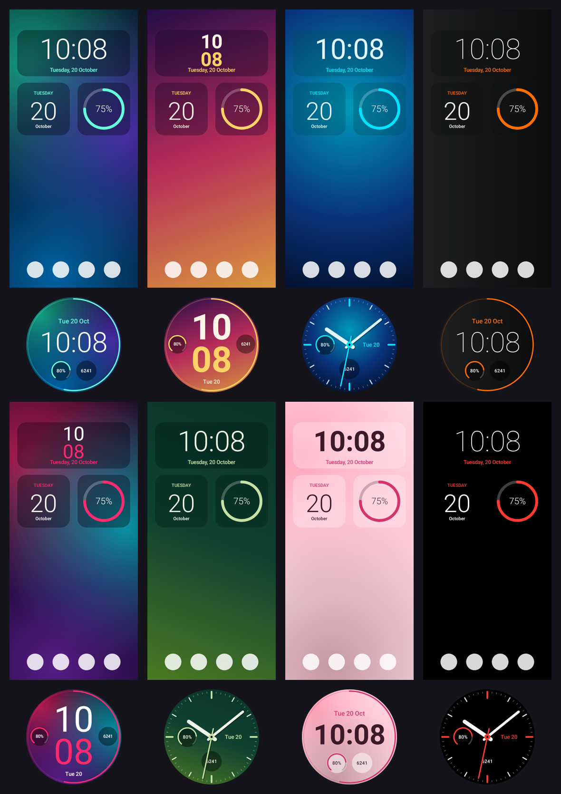

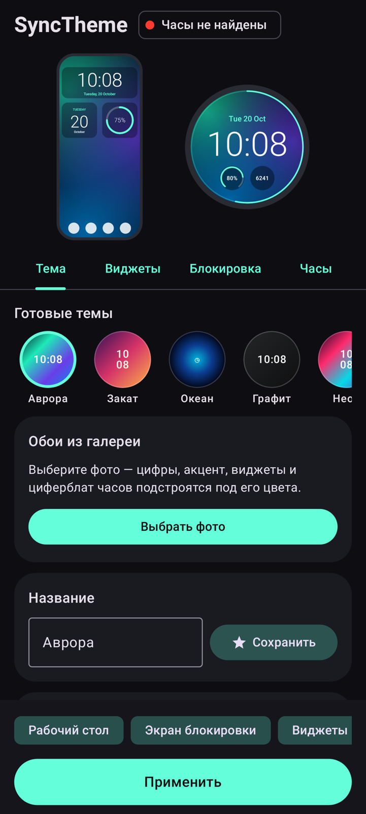 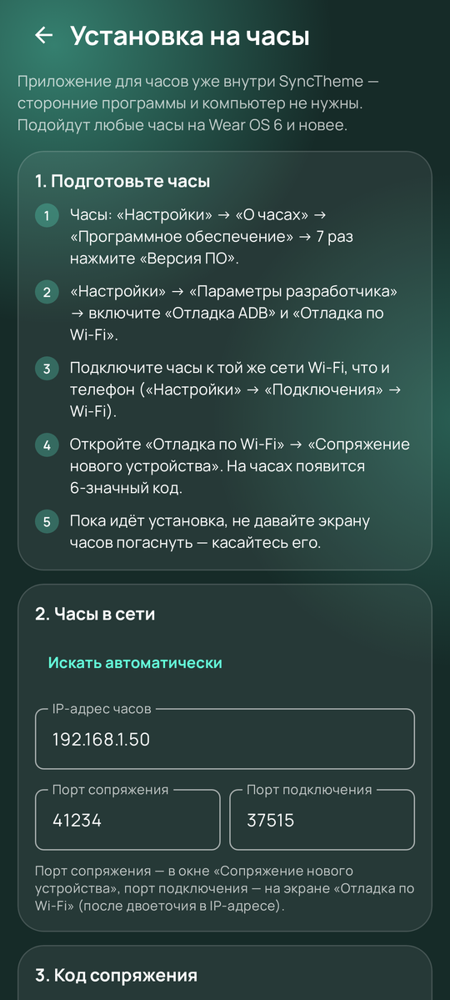

## Что умеет

| | |
|---|---|
| Свои темы | готовых тем нет — вы создаёте свои: тип фона, до 4 цветов градиента или фото, угол, затемнение, цвет цифр и акцента, стиль циферблата |
| Тема из фото | «Из фото» в «Моих темах»: выбираете снимок — и тема готова в один шаг: фото на обоях и экране блокировки, цвета цифр, акцента, виджетов и циферблата по снимку, часы за объектом, если включены «Часы на обоях». Тема сразу сохраняется — остаётся «Применить» |
| Светлая и тёмная | у каждой темы: «Как есть», «Светлая», «Тёмная» или «Как в системе» — днём светлая, при тёмной теме телефона тёмная. Обои с часами и виджеты (Android 12+) переключаются в ту же секунду, что и телефон; циферблат часов всегда тёмный |
| Картинка из Pinterest или браузера | «Поделиться» → «Обои в SyncTheme»: картинка сразу становится обоями в редакторе, в галерею телефона её сохранять не нужно |
| Расположение | часы на обоях, время на циферблате и само фото двигаются пальцем, размер — щипком |
| Экран блокировки | те же обои или отдельные (свой фон, фото, затемнение); по желанию — часы SyncTheme за объектом фото, как на рабочем столе |
| Виджеты | Часы, Календарь, Погода, Батарея и Приложения — в пяти непохожих стилях: «Стекло», «Плакат», «Неон», «Бумага» и «Табло»; у часов — шесть шрифтов цифр разной формы. Любая форма и размер от 1×1 до 4×4 и столбиков 1×5: квадрат, столбик, высокий, полоска, широкий — у каждой своя раскладка. Нажатие открывает нужное приложение. У погоды — небо под текущую погоду и полоски «мин–макс» на 5 дней, у часов — небо по времени суток, у батареи — цвет по состоянию |
| Папка приложений | виджет «Приложения» — спокойный значок папки или невидимое место на рабочем столе. Нажатие раскрывает до 12 приложений вдоль линии: готовой («Дуга», «Столбик», «Строка», «Волна», «Кольцо», «Сетка») или своей, нарисованной поверх рабочего стола: пальцем (линия сама становится плавной), ровной дугой или прямой — и поправленной за точки. 5 анимаций, фон и затемнение — по галочкам |
| Циферблат | 15 стилей, из них 12 «живых»: «Барабан», «Колонки», «Планеты», «Матрица», «Заливка», «Диагональ», «Крупно», «Орбита», «Неон», «Облако», «Стекло», «Минимал». Шесть шрифтов цифр. По умолчанию повторяет телефон; можно настроить отдельно. У каждого стиля свой контрастный вид Always-On |
| Эффект глубины | главный объект фото (человек, питомец, гора) целиком закрывает цифры — на циферблате, в «Часах на обоях» и на экране блокировки, одинаково на любом телефоне. Объект можно обвести пальцем — границы телефон найдёт сам |
| Часы на обоях | живые обои SyncTheme: крупные часы прямо на обоях рабочего стола (вверху, столбиком или по центру). Нажатие на часы открывает выбранное приложение |
| «Мои темы» | «Сохранить как новую» добавляет тему рядом с прежними (одинаковые имена получают номер: «Закат 2»), «Обновить эту тему» меняет только открытую. В ленте — живые миниатюры: обои с виджетами и циферблат |
| Устройства | по умолчанию — только телефон. По желанию и в любом количестве: часы на Wear OS 6+ (циферблат в цветах темы), планшеты и телефоны (та же тема по Wi‑Fi), телевизоры с Google TV (заставка в цветах темы) |
| Оформление приложения | «Стекло», «Экспрессив» или «Неон»; светлое, тёмное или как в системе. Акцент всегда берётся из обоев |

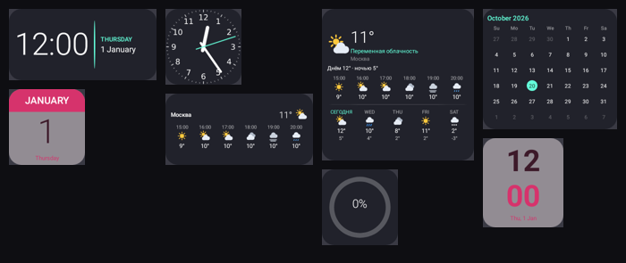

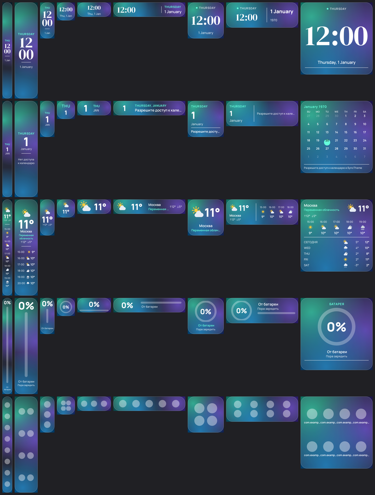

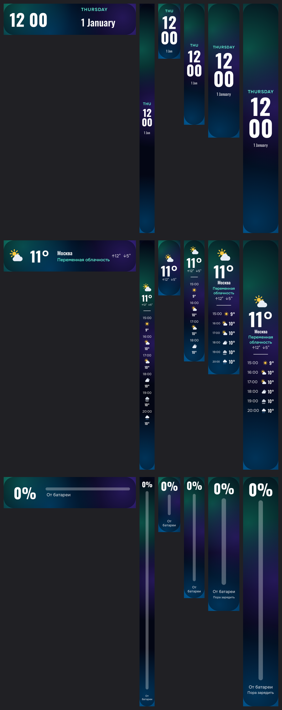

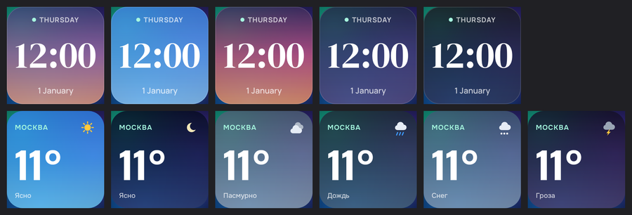

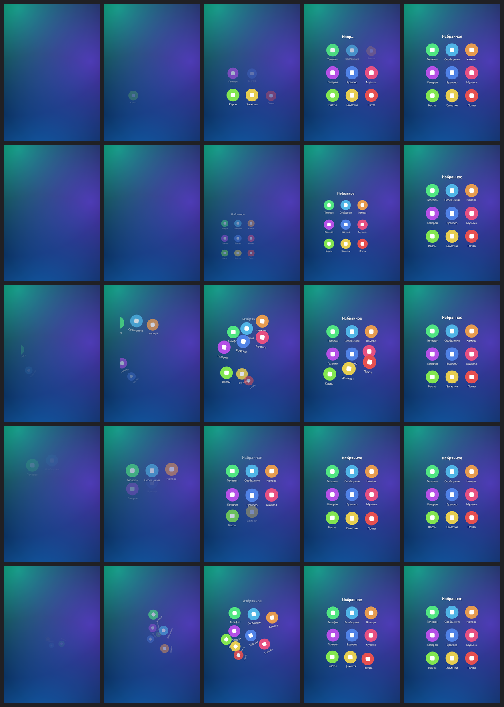

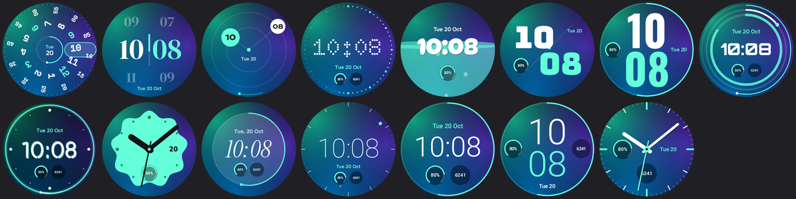

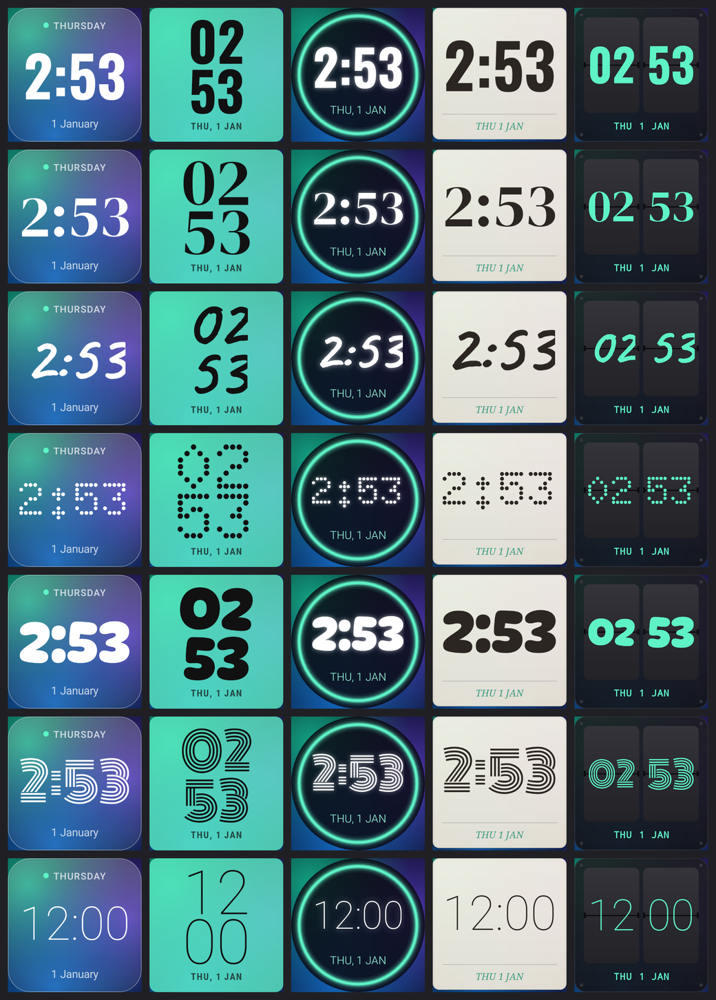

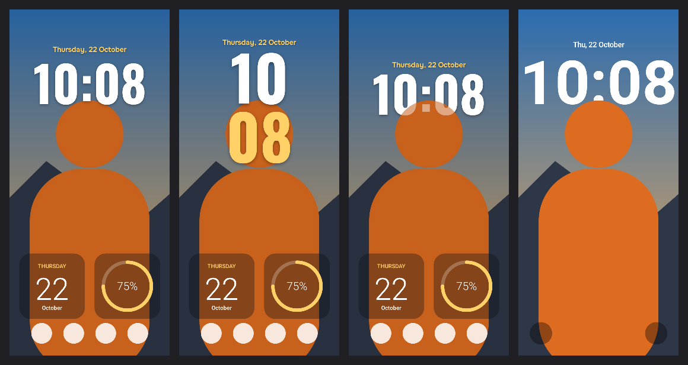

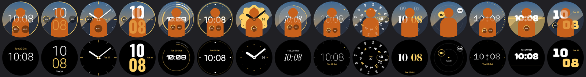

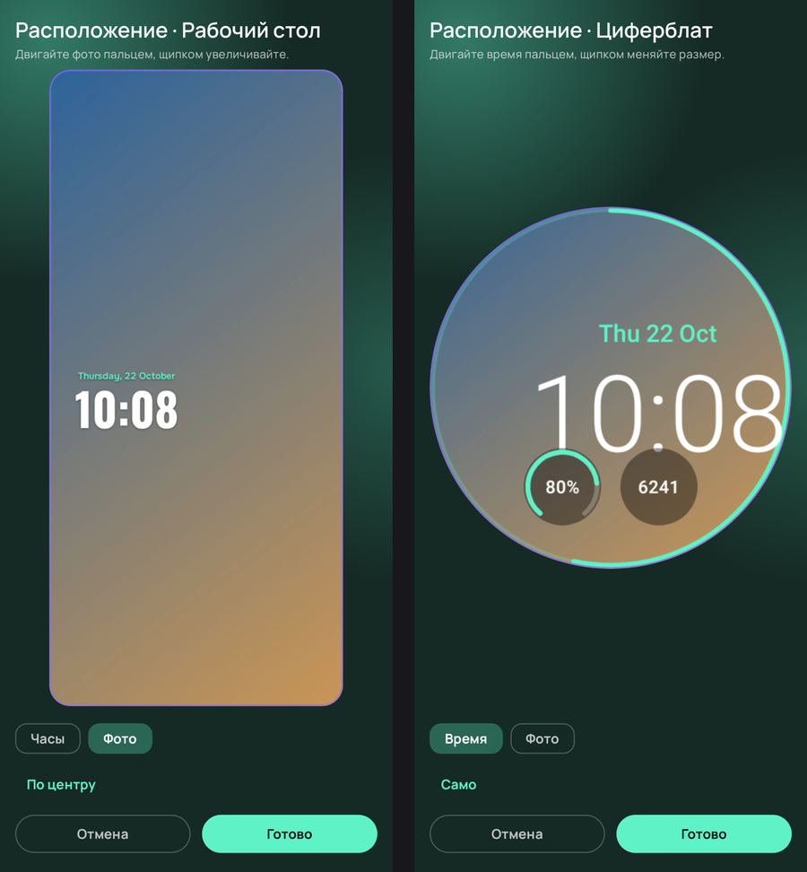

## Требования

- **Телефон на Android 9 или новее** — любой марки: Samsung, Pixel, Xiaomi, OnePlus и другие. Обои, виджеты, часы на обоях с эффектом глубины (и на рабочем столе, и на экране блокировки) и папка приложений работают везде. Что именно есть на вашем телефоне, приложение покажет при первом запуске («Настройки» → «Что работает на этом телефоне»). На старых Android (9–11) виджеты немного проще: их размер и выравнивание задаёт рабочий стол.
- **Планшет или другой телефон на Android 9 или новее** (по желанию): например, Galaxy Tab S9 FE. На него ставится тот же `SyncTheme-phone.apk`.
- **Телевизор или приставка с Google TV / Android TV 9+** (по желанию): например, Tuvio 4K с Google TV. SyncTheme на телевизор ставит сам телефон.
- **Часы на Wear OS 6 или новее** (по желанию), подключённые к телефону: Galaxy Watch4–Watch8 и Watch Ultra с One UI 8 Watch, Google Pixel Watch 2–4. На Wear OS 6 есть Watch Face Push — без него свой циферблат на часы не поставить. Проверить версию на Galaxy Watch: Galaxy Wearable → «Настройки часов» → «О часах» → «Обновление ПО».

Устройства добавляются в «Настройки» → «Устройства» → «Добавить устройство». Пока их нет, в приложении нет ни вкладки «Часы», ни лишних кнопок.

Приложение подстраивается под поворот экрана: боком — меню слева, превью и «Применить» в середине, настройки справа; на планшете своё превью — экран планшета.

## Установка

Нужен один файл — `SyncTheme-phone.apk`. Приложение для часов уже встроено в него и ставится на часы прямо из приложения по «Отладке по Wi‑Fi». Компьютер и сторонние программы не нужны.

### 1. Телефон

1. Скопируйте `SyncTheme-phone.apk` на телефон и откройте его. Если файл скачался как `.zip`, переименуйте его обратно в `.apk` («Мои файлы» → зажать файл → «Переименовать»). Распаковывать файл не нужно.
2. Если установка заблокирована, разрешите установку из этого источника. На Samsung может понадобиться временно выключить «Настройки» → «Безопасность и конфиденциальность» → **«Автоблокировщик»**.
3. Установите приложение и откройте **SyncTheme**.

### 2. Часы — по желанию, из приложения

1. В SyncTheme откройте «Настройки» → «Устройства» → **«Добавить устройство»**. Часы, подключённые к телефону по Bluetooth, будут в списке:
   - если SyncTheme на часах уже есть — **«Подключить»**, и всё;
   - если нет — **«Подключить и установить»**: откроется установка. Это нужно один раз: SyncTheme нет в Google Play, а приложения не из Play Маркета Wear OS ставит только через «Отладку по Wi‑Fi». Дальше часы подключаются сами по Bluetooth.
2. Выберите свои часы в списке — подсказки ниже покажут пункты меню именно для них. Подготовьте часы (это нужно один раз):
   - Galaxy Watch: «Настройки» → «О часах» → «Программное обеспечение» → 7 раз нажмите **«Версия ПО»**; Pixel Watch: «Настройки» → «Система» → «О часах» → «Версии» → 7 раз «Номер сборки»;
   - «Настройки» → «Параметры разработчика» (или «Для разработчиков») → включите **«Отладка ADB»** и **«Отладка по Wi‑Fi»**;
   - часы и телефон должны быть в **одной сети Wi‑Fi**;
   - на часах: «Отладка по Wi‑Fi» → **«Сопряжение нового устройства»** (на Pixel Watch — «Подключить устройство по коду»).
3. Телефон сам найдёт часы в сети. Введите **6-значный код** с экрана часов и нажмите **«Установить на часы»**.
4. Приложение передаст программу на часы, установит её, выдаст разрешение менять циферблат и откроет SyncTheme на часах.
5. После этого «Отладку по Wi‑Fi» на часах можно выключить: она расходует батарею.

Модель часов SyncTheme определяет сам по имени часов и показывает шаги именно для неё.

Если часы не находятся автоматически (некоторые роутеры блокируют поиск устройств), нажмите «Ввести адрес вручную». IP-адрес и порт подключения указаны на экране «Отладка по Wi‑Fi», порт сопряжения — в окне «Сопряжение нового устройства».

Если не удаётся подключиться («Часы не ответили на команду», «Подключаюсь к часам…»):

- не давайте экрану часов погаснуть, пока идёт установка;
- Galaxy Watch отключает Wi‑Fi, пока связаны с телефоном по Bluetooth. На время установки выключите на часах Bluetooth («Настройки» → «Подключения» → Bluetooth), затем включите обратно;
- если на телефоне включён VPN (значок ключа в строке состояния), SyncTheme подключается к часам напрямую через Wi‑Fi, но некоторые VPN этого не дают — выключите VPN на время установки;
- нажмите «Сделать сопряжение заново» и введите новый код.

Каждый шаг подключения ограничен по времени: если часы не отвечают, SyncTheme сам переподключится (до 3 попыток) и скажет, на каком шаге они замолчали.

Внизу экрана установки есть «Журнал» с кнопкой «Скопировать»: по нему видно, на каком шаге возникла проблема.

**Другие часы.** Если вы смените часы, подключите их к телефону и добавьте в «Настройки» → «Устройства» → «Добавить устройство». Подходят часы из списка выше — Galaxy Watch и Pixel Watch на **Wear OS 6 и новее**. Когда выйдет новая версия приложения для телефона, SyncTheme сам предложит обновить приложение и на часах.

Запасной вариант без встроенного установщика: файл `SyncTheme-watch.apk` можно поставить с компьютера (`adb pair`, `adb connect`, `adb install`) или через Bugjaeger / Wear Installer 2.

### 3. Планшет или другой телефон — по желанию, по Wi‑Fi

1. Установите тот же `SyncTheme-phone.apk` на планшет (как в шаге 1).
2. На планшете: SyncTheme → «Настройки» → «Устройства» → включите **«Принимать тему с телефона»** (на другом телефоне — раскройте «Получать тему с другого телефона»). Там же нажмите «Работать в фоне без ограничений», чтобы планшет принимал тему и с выключенным экраном.
3. На телефоне: «Настройки» → «Устройства» → **«Добавить устройство»** и нажмите «Подключить» у планшета в списке.
4. На планшете появится «Подключить телефон …?» с 6-значным кодом — тот же код показан на телефоне. Нажмите **«Подключить»**. Вводить ничего не нужно.

Если планшет не нашёлся (некоторые роутеры блокируют поиск устройств), откройте «Планшет или другой телефон» и введите адрес, который показан на планшете.

Сразу после подключения телефон отправляет на планшет тему, которая сейчас стоит на телефоне. Если планшет был недоступен (выключен, в другой сети), телефон сам повторит отправку, когда он появится в сети, — состояние видно в «Устройствах» и в шапке главного экрана. Кнопка «Отправить тему» отправляет её ещё раз вручную, переключатель у строки устройства — временно не отправлять на него тему.

Телефон и планшет должны быть в одной сети Wi‑Fi. Подключить нужно один раз: дальше каждое «Применить» на телефоне отправляет тему (с фото) на все подключённые устройства сразу, и они сами ставят обои и перекрашивают виджеты — даже когда SyncTheme на них закрыт. Тема передаётся только внутри домашней сети и зашифрована ключом, о котором устройства договорились при подключении (обмен ключами ECDH; одинаковый код на обоих экранах подтверждает, что посередине никого нет). Отключить: на телефоне «Отключить», на планшете — выключить «Принимать тему с телефона».

Планшеты, связанные в версиях до 1.17, остаются в списке. Если тема на такой планшет не уходит, обновите SyncTheme и на нём, а затем подключите его заново.

### 4. Телевизор с Google TV — по желанию, с телефона

На телевизоре SyncTheme — это **заставка**: обои темы во весь экран и крупные часы с датой (часы понемногу смещаются, чтобы экран не выгорал). Новая тема с телефона появляется на заставке сама по «Применить».

1. Подготовьте телевизор (один раз): «Настройки» → «Система» → «Об устройстве» → 7 раз нажмите пультом **«Сборка ОС Android TV»**. Затем «Настройки» → «Система» → **«Для разработчиков»** → включите **«Отладка по USB»** (если есть — и «Отладка по сети»). Телевизор и телефон — в одной сети Wi‑Fi.
2. На телефоне: «Настройки» → «Устройства» → «Добавить устройство» → «Телевизор с Google TV» → **«Установить на телевизор»**. Телефон сам найдёт телевизор в сети (или введите его IP-адрес: на телевизоре «Настройки» → «Сеть и Интернет» → ваша сеть).
3. Нажмите **«Установить на телевизор»**. На телевизоре появится «Разрешить отладку?» — выберите «Всегда разрешать с этого компьютера» и нажмите **«OK»** пультом. Если на телевизоре есть «Отладка по Wi‑Fi», можно вместо этого включить её и ввести код из «Подключить устройство с помощью кода».
4. Телефон поставит SyncTheme на телевизор, сделает его заставкой (на Google TV стороннюю заставку в настройках обычно не выбрать — телефон включает её сам) и откроет SyncTheme на телевизоре.
5. Нажмите **«Подключить телевизор»** на телефоне и **«Подключить»** пультом на телевизоре — и тема уже на заставке. Отладку на телевизоре теперь можно выключить.

На телевизоре SyncTheme есть и в списке приложений: там превью заставки, «Показать заставку» (сразу, не дожидаясь простоя), «Сделать заставкой», состояние подключения и «Проверить обновления». Запасной путь установки — приложение Downloader на телевизоре и адрес `github.com/0WahTanG0/SyncTheme/releases/latest/download/SyncTheme-phone.apk`; тогда заставку выберите в настройках телевизора.

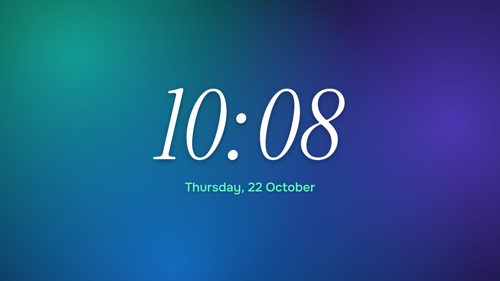

### 5. Первый запуск

Внизу — меню: **Обои** (рабочий стол и экран блокировки), **Виджеты**, **Часы** (когда часы подключены) и **Настройки** (устройства, оформление приложения, обновления). Превью сверху показывает то, что вы настраиваете, и сжимается при прокрутке.

1. В разделе «Обои» нажмите «Из фото» (тема соберётся сама) или выберите градиент, при желании раскройте «Фон» и «Цвета», и сохраните тему («Сохранить как новую»). Рядом с «Применить» значками отмечено, куда применять: экран, блокировка, виджеты, а если подключены — часы и каждое устройство. Нажмите **«Применить»** — кнопка ярко подсвечена, пока есть неприменённые изменения.
2. С часами: вверху написано «Часы на связи: …», а телефон соберёт циферблат (несколько секунд) и отправит его на часы.

Каждое «Применить» обновляет циферблат на часах автоматически. Пока вы настраиваете тему, телефон заранее собирает циферблат в фоне, поэтому по «Применить» он сразу уходит на часы — первым, параллельно с обоями и виджетами. Циферблат весит около 100 КБ (только нужные шрифты и сжатое превью), так что по Bluetooth передаётся за пару секунд; ещё несколько секунд часы устанавливают его. Если часы были не на связи, циферблат установится, когда они подключатся. Если часы всё же попросят разрешение менять циферблат, откройте SyncTheme на часах → «Сделать циферблатом» → «Разрешить».

### Оформление приложения

Раздел «Настройки» → «Оформление приложения»:

- **Стекло** — полупрозрачные карточки и мягкое цветное свечение за ними;
- **Экспрессив** — тональные цвета, крупные скругления и «живые» формы;
- **Неон** — сетка, светящиеся рамки и кнопки.

Под ними переключатель «Как в системе / Светлая / Тёмная». В любом стиле акцентный цвет берётся из текущих обоев, поэтому вместе с темой меняется и приложение.

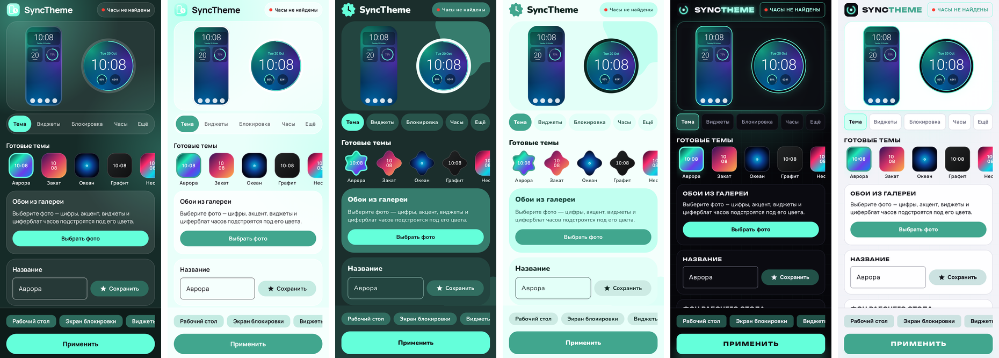

Иконка приложения — неоновое кольцо. Если включены значки в цвет обоев (тематические значки Android 13+, палитра в One UI), она перекрашивается вместе с остальными.

### Обновления

Новую версию не нужно удалять и ставить заново: она ставится поверх текущей, а темы, настройки и сопряжение с часами сохраняются.

- **Из приложения:** раздел «Обновления» → «Проверить» → «Скачать и обновить». Приложение берёт новые версии из релизов GitHub-репозитория, указанного в поле «Источник». При первом обновлении Android один раз попросит разрешить SyncTheme устанавливать приложения.
- **Из файла:** «Обновления» → «Из файла APK» → выберите скачанный `SyncTheme-phone.apk`. Подойдёт и файл, который скачался как `.zip`.
- Если в новой версии обновилось и приложение для часов, в разделе «Часы» появится кнопка «Обновить SyncTheme на часах».

Перед установкой приложение проверяет, что APK подписан тем же ключом, что и установленная версия. Чужой файл обновлением не поставится.

### Виджеты

Раздел «Виджеты» → «Добавить» под нужным виджетом (в ленте сверху — живые превью). Рабочий стол предложит разместить виджет, а затем откроется его настройка с живым превью на ваших обоях. Переключатель размеров в клетках рабочего стола («1×1», «2×1», «4×1», «1×2», «1×4», «2×2», «2×4», «4×2», «4×4») показывает, как виджет выглядит в каждой форме.

- **Стиль** — один из пяти, общих для всех видов виджетов:
  - «Стекло» — матовое стекло, сквозь которое видно обои, тонкие цифры; у часов и погоды — небо по времени суток или по погоде;
  - «Плакат» — сплошной цвет акцента, огромные узкие цифры и жирные подписи, как на афише;
  - «Неон» — светящийся контур и цифры на чёрном;
  - «Бумага» — кремовый лист с тенью, буквы с засечками, чернила;
  - «Табло» — графитовая панель, числа на перекидных плашках, как на вокзальном табло.
  Виджеты прошлых версий сами переходят на самый похожий из новых стилей.
- **Шрифт цифр** у часов — шесть разных по форме: узкий гротеск, антиква с засечками, рукопись, точки (LED-матрица), пузыри и ретро-линии. «Как в стиле» — шрифт, задуманный для стиля.
- **Размер и форма**: растяните виджет на рабочем столе — он покажет больше. Пример с погодой: 1×1 — значок и температура, 2×2 — ещё город, 4×2 — прогноз на 5 часов, 4×4 — ещё прогноз на 5 дней. Часы в большом размере показывают дату и следующий будильник, календарь — события и месяц, батарея — время до полной зарядки и температуру.
- **Вытянутые виджеты** не растягивают квадратную картинку, а перестраиваются. В низкой полоске (4×1) главное значение во всю высоту, а подписи рядом. В столбике (1×2…1×5) и высоком виджете (2×3…2×5) — наоборот: главное значение во всю ширину, а подписи и строки под ним одной группой по центру, без пустот. Часы — «12» над «00», день недели и дата; календарь — число, месяц и события; погода — температура, город и почасовой прогноз (до 6 часов, сколько поместится); батарея — процент, полоса заряда во всю высоту и состояние; приложения — до 8 значков. Кегль цифр подбирается по точному размеру виджета, который сообщает рабочий стол, поэтому цифры всегда крупные и целиком, а строки, которые не помещаются, прячутся, а не обрезаются.
- **По нажатию** открывается своё приложение: часы — будильники, календарь — календарь, батарея — настройки батареи, погода — Погода Samsung (или другое приложение погоды). В настройке виджета можно выбрать любое другое приложение.
- **Приложения** — три вида на рабочем столе:
  - **«Значок папки»** (у нового виджета — по умолчанию) — спокойный значок одного цвета: фигура стиля и четыре точки или силуэты приложений, без цветных значков, чтобы не шуметь на рабочем столе. Нажатие раскрывает папку поверх рабочего стола (рабочий стол за ней размывается);
  - **«Невидимый»** — на рабочем столе ничего не видно: поставьте виджет, например, на свободное место у часов или на объект обоев, и нажатие на это место раскроет папку. Границы виджета видны, когда вы его перемещаете;
  - **«Значки»** — как раньше: до 8 значков прямо на виджете, в широком и большом размере с подписями.

  **Как раскрывается** — раздел «Как раскрывается» в настройке виджета:
  - готовые линии от виджета: **«Дуга»**, **«Столбик»**, **«Строка»**, **«Волна»**, **«Кольцо»** (вокруг виджета) и **«Сетка»** посреди экрана. Линия сама поворачивает к середине экрана и вписывается в свободное место; если не помещается — уходит в другую сторону, а значки становятся мельче;
  - **своя линия**: «Нарисовать на рабочем столе» → откроется главный экран, а над ним — прозрачный слой. Проведите линию от места, откуда раскрывается папка, туда, куда лягут приложения, прямо поверх своих значков и виджетов. Инструменты сверху: «Пальцем» — изгибы любые, а дрожание руки сглаживается в плавную кривую; «Дуга» — ровная дуга от начала к концу, изгиб меняется точкой посередине; «Прямая». Готовую линию можно поправить — потянуть за её точки, а «Ровнее» убирает лишние изломы. В альбомной ориентации линия своя: рабочий стол боком устроен иначе. Значки папки сразу показываются в настоящем размере там, где лягут; «Готово» возвращает в настройку. Ещё быстрее — откройте папку на рабочем столе и задержите палец на пустом месте: линия нарисуется на той же странице и сразу сохранится в виджет. Нарисованные линии сохраняются как «Моя линия 1, 2…» — их можно выбрать и для других папок.

  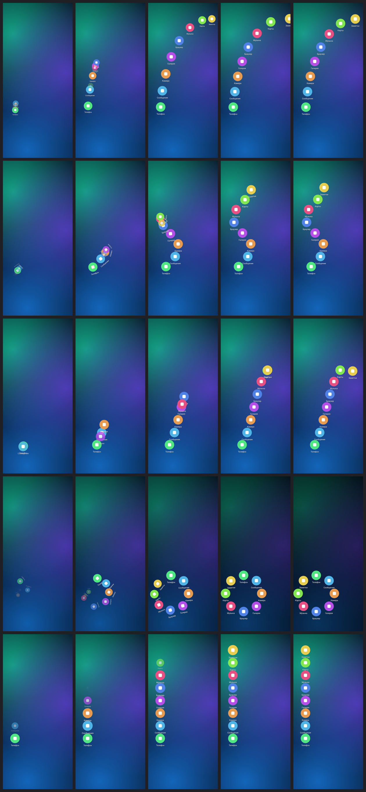

  **Анимация** — **«Раскрытие»** (значки проявляются по очереди), **«Пружина»** (летят по линии и чуть проскакивают место), **«Веер»** (катятся по линии, вращаясь), **«Каскад»** (друг за другом, как вагончики), **«Спираль»** (кружатся вокруг линии, сходясь к месту). У «Сетки» — свои варианты тех же анимаций. Кнопка «Посмотреть, как раскрывается» показывает анимацию прямо из настройки.

  **Галочки**: «Подписи под значками», «Фон и контур папки» (у «Сетки») и «Затемнять рабочий стол» (затемнение и размытие за папкой). Фон и затемнение по умолчанию выключены — значки лежат прямо на рабочем столе, подписи с тенью читаются на любых обоях.

  Нажатие на приложение открывает его, нажатие мимо или «Назад» — сворачивает папку обратно в виджет. Цвета и форма значков — как у стиля виджета: «Стекло», «Плакат», «Неон», «Бумага», «Табло».

  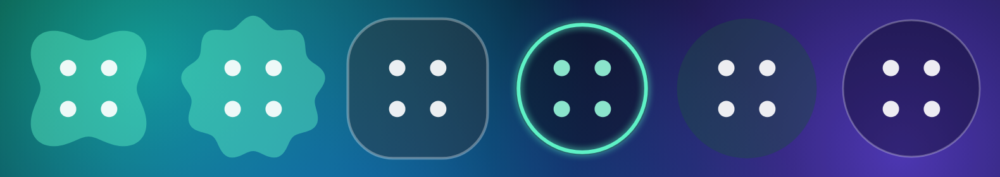
- **Небо.** У погоды фон — небо под текущую погоду: ясно, облачно, дождь, снег, гроза, туман, днём и ночью (переключатель «Фон по погоде»). У часов — «Небо по времени суток»: рассвет, день, закат, вечер и ночь сменяются сами. Текст на небе светлый. У «Неона» вместо неба своё свечение.
- **Прогноз на 5 дней** — с полосками «мин–макс», как в погоде iPhone: длина и место полоски показывают разброс температуры за неделю, цвет — от голубого (холодно) до оранжевого (жарко), точка на сегодняшней — температура сейчас.
- **Батарея** зеленеет при зарядке, при 30 % и меньше становится янтарной, при 15 % — красной. В большом виджете сверху — имя телефона, состояние батареи показывается, только если с ней что-то не так.
- **Календарь**: у каждого события цветная полоска его календаря; в сетке месяца сегодняшний день отмечен ровно на числе.
- **Подложка** с прозрачностью от 0 до 100% и **цвета**: из темы или свои; для стрелок — секундная стрелка.

Изменить настройки позже: зажмите виджет → «Настройки» или раздел «Виджеты» → «На экране» → «Настроить». Там же можно задать прозрачность сразу для всех виджетов. Виджет «Дата» из прошлых версий объединён с «Календарём»: уже добавленные продолжают работать.

**Погода** берётся с Open-Meteo (бесплатно, без регистрации). Город можно найти по названию или нажать «Моё местоположение». Обновляется каждые 30 минут.

**Календарь** показывает число, ближайшие события из календаря телефона (нужно разрешение на чтение календаря) и, в размере 4×4, весь месяц.

### Циферблаты

Раздел «Часы» → «Циферблат»: стили показаны картинками в цветах вашей темы. Свои фон и цвета для часов — «Фон и цвета часов».

- **Крупно** — часы над минутами огромными узкими цифрами, секунды бегут по краю;
- **Орбита** — три кольца заполняются вместе со временем: часы, минуты и секунды с бегущими точками;
- **Неон** — светящееся кольцо, секунды — «комета» с хвостом, время с цветным ореолом;
- **Облако** — толстые стрелки на «печенье» цвета акцента;
- **Стекло** — матовый диск, по его краю бегут секунды;
- **Минимал** — тонкие цифры и одна точка цвета акцента, которая обходит круг за час;
- **Барабан** — кольца с цифрами часов и минут вращаются, текущее время проходит через окошко справа;
- **Колонки** — час и минута столбиками вместе с прошлым и следующим значением, секунды растут шкалой между ними;
- **Планеты** — часы и минуты летают шарами по своим орбитам, секунды — спутник с хвостом;
- **Матрица** — точечные цифры и 60 огоньков секунд, прошедшие загораются;
- **Заливка** — за минуту циферблат наполняется «жидкостью» с волной и пузырьками;
- **Диагональ** — часы слева сверху, минуты справа снизу, секунда бежит по диагонали;
- классические: «Классика», «Вертикально», «Стрелки».

Шрифт цифр выбирается там же (шесть, как у виджетов); у каждого стиля свой по умолчанию.

**Always-On.** У каждого стиля свой вид для режима Always-On: фон гаснет, секунды и мини-виджеты прячутся, а время и дата рисуются светлыми контрастными цветами на чёрном — у «Планет» контурные шары, у «Облака» светлые стрелки и метки часов, у «Барабана» остаётся окошко с текущим временем, у «Колонок» — только текущие час и минута. Превью — в «Часы» → «На циферблате».

### Эффект глубины

Нужен фон-фото с заметным главным объектом — человек, питомец, гора. SyncTheme один раз находит объект на телефоне (ML Kit, модель скачивается через сервисы Google Play при первом включении) и кладёт его отдельным слоем поверх цифр. Маска объекта считается заново, когда меняется фото: при «Применить» и прямо в живых обоях, если её ещё нет.

Часы стоят **за объектом и с противоположной от него стороны**: объект справа — часы слева, слева — справа, сверху — снизу, снизу — сверху. Объект лишь слегка заходит на цифры: около десятой части их площади и не больше трети одной цифры — и то, что он закрыл, действительно за ним, как на фото.

**Выбрать объект вручную:** «Часы на обоях» → «Выбрать объект». Обведите объект пальцем примерно — SyncTheme сам найдёт его точные границы внутри обводки. «Убрать» снимает лишнее, «Кисть» и «Ластик» правят край, «Найти сам» ищет заново на всём фото. Если телефон не нашёл объект сам (или на нём нет сервисов Google), этот экран открывается сразу.

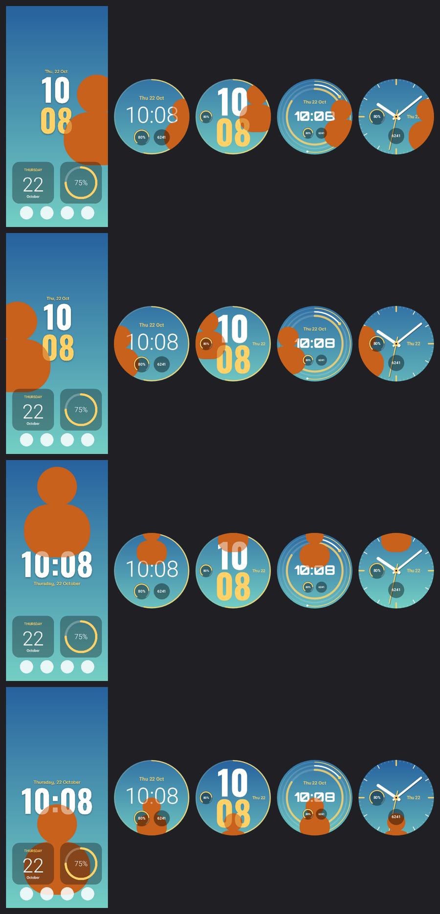

- **На часах:** «Часы» → «На циферблате» → «Эффект глубины». Фото остаётся как есть, а время (цифры вместе с датой) само переезжает на противоположную от объекта сторону и при необходимости чуть уменьшается, чтобы объект заходил на цифры лишь краем. Кольца, деления и мини-виджеты стоят на месте; мини-виджеты остаются поверх объекта, в режиме Always-On — только время. У «Стрелок», «Облака», «Планет» и «Барабана» время привязано к центру циферблата — там в «Расположении» двигают фото.
- **На рабочем столе:** «Обои» → «Часы на обоях» — крупные часы прямо на обоях, свой шрифт и дата, переключатель «Эффект глубины». С глубиной место часов выбирается по объекту: одной строкой сверху или снизу от него, часы над минутами — сбоку. Без глубины — раскладка на выбор: вверху, столбиком или по центру. Кнопка «Подвинуть часы» ставит их куда угодно вручную. Один раз включите живые обои SyncTheme кнопкой «Включить живые обои» и выберите «Главный экран». Дальше время и тема меняются на них сами, кадр перерисовывается при включении экрана и разблокировке; значки и виджеты лежат поверх. **Нажатие на часы** открывает приложение — по умолчанию будильники, другое выбирается кнопкой «Выбрать приложение» (переключатель «Открывать приложение по нажатию»). Касания рабочего стола система передаёт и обоям, поэтому обои сами узнают короткое нажатие на часы; свайпы и долгие нажатия не считаются. Если над часами лежит папка, значок или меню, нажатие откроет их, а не приложение часов: часы ждут долю секунды и ничего не открывают, если за это время раскрылась папка SyncTheme, лаунчер что-то раскрыл или открылось другое приложение. Лаунчеры, которые сами сообщают о нажатии на пустое место (Pixel, Nova и др.), — по их сообщению.
- **На экране блокировки:** «Обои» → «Экран блокировки» → «Часы и эффект глубины» → «Часы SyncTheme на экране блокировки». Работают через те же живые обои SyncTheme (выберите «Главный экран и экран блокировки»), на любом телефоне. Свои часы телефона при этом остаются — их стиль и размер меняются в настройках экрана блокировки самого телефона.

### Расположение: подвинуть часы и фото

Если автоматическое место не понравилось, нажмите «Подвинуть часы и фото» в «Часах на обоях», «Подвинуть фото» в «Фоне» или «Подвинуть время и фото» в «Часы» → «На циферблате». Откроется редактор с превью во весь экран:

- **Часы / Время** — тащите пальцем, щипком меняйте размер. На рабочем столе есть переключатель «Одной строкой / Часы над минутами», на циферблате время не уходит за край круга;
- **Фото** — двигайте кадр и увеличивайте щипком. На часах кадр фото настраивается отдельно от телефона;
- **«Само»** возвращает автоматическое место по объекту, **«Готово»** сохраняет. Как обычно, на телефон и часы изменения уходят по «Применить».

- **Дата, погода и заряд** — у каждой подписи свой чип: её можно поставить в любое место экрана отдельно от часов и щипком изменить размер. «Вернуть к часам» ставит подпись обратно над или под цифрами.

Новое фото сбрасывает ручное место часов — они снова встают по объекту.

### Картинка из Pinterest, браузера и других приложений

Скачивать картинку на телефон не нужно. В Pinterest, браузере, галерее или мессенджере нажмите **«Поделиться»** → **«Обои в SyncTheme»**. Приложение откроется и само получит картинку: из ссылки на пин — в исходном размере, из ссылки на страницу — её главную картинку (ту, что сайт показывает в превью ссылки). Картинка сразу становится обоями рабочего стола в редакторе: подвиньте фото и часы, если нужно, поправьте цвета и нажмите «Применить». Файл хранится только внутри SyncTheme и в галерею не попадает. Нужен интернет; картинки до 30 МБ.

### Устройства

«Настройки» → «Устройства»: этот телефон (модель, Android, у Samsung — и One UI) и подключённые к нему устройства — у каждого строка с состоянием («На связи», «Тема «Закат» на месте · 12:03», «Не ответил — …»), переключателем «получает тему» и кнопками «Отправить тему» / «Отключить». Новое устройство — одной кнопкой **«Добавить устройство»**: там видно, что нашлось рядом (часы — по Bluetooth, планшеты, телевизоры и телефоны — в сети Wi‑Fi), и подсказки, как подключить то, чего в списке нет. Пока ничего не подключено, «Применить» трогает только телефон. Кто уже пользовался часами, после обновления их не теряет — часы остаются подключёнными.

## Важные особенности Wear OS

- Wear OS 6 даёт приложению **один** слот под циферблат. Поэтому SyncTheme не создаёт новые циферблаты, а обновляет свой «SyncTheme».
- Включить свой циферблат автоматически приложение может **только один раз** (ограничение Google). Если позже вы выбрали другой циферблат, вернуть SyncTheme можно так: зажмите экран часов → пролистайте до «SyncTheme».
- Мини-виджеты на циферблате (по умолчанию батарея и шаги) можно поменять: зажмите циферблат → «Настроить». Ваш выбор сохраняется при смене темы.
- В режиме Always-On фон гаснет, остаются только светлые цифры или стрелки, чтобы экономить заряд и не выжигать экран.

## Если что-то не работает

**Часы спешат или отстают.** Циферблат показывает системное время часов. Раздел «Часы» → кнопка «Время» сверяет часы с телефоном (с поправкой на задержку Bluetooth), а телефон — с точным временем из интернета, и подсказывает, где включить автоматическое время. На часах кнопка «Настройки времени» есть в SyncTheme. Для проверки нужно SyncTheme для часов версии 1.3 или новее.

| Проблема | Что сделать |
|---|---|
| «Часы не найдены» | Проверьте Bluetooth и подключение в приложении часов (Galaxy Wearable, Pixel Watch, Wear OS) |
| «Часы подключены, но SyncTheme на них не установлен» | Нажмите «Установить SyncTheme на часы» (раздел 2) |
| Установщик не находит часы | Часы и телефон в одной сети Wi‑Fi? На часах включена «Отладка по Wi‑Fi»? Если да — введите адрес вручную |
| «Сопряжение не удалось» | Код меняется при каждом открытии окна «Сопряжение нового устройства» — откройте окно заново и введите новый код |
| «Часы не принимают циферблаты» | Обновите ПО часов до Wear OS 6 (на Galaxy Watch — через Galaxy Wearable) |
| «Эффект глубины» не включается | Нужен фон-фото с заметным объектом и сервисы Google Play (для загрузки модели) |
| Часы на обоях не появились | «Обои» → «Часы на обоях» → «Включить живые обои» и подтвердите на экране обоев |
| На экране блокировки нет часов SyncTheme | Включите «Часы SyncTheme на экране блокировки» и поставьте живые обои SyncTheme на «Главный экран и экран блокировки» |
| Объект на фото выделен не тот | «Часы на обоях» → «Выбрать объект» и обведите нужный пальцем |
| «Часы не ответили на команду» | Разбудите экран часов; выключите на часах Bluetooth и на телефоне VPN на время установки; повторите |
| «Разрешите сменить циферблат» | Откройте SyncTheme на часах → «Сделать циферблатом» |
| Отказали в разрешении | Часы → «Настройки» → «Приложения» → SyncTheme → «Разрешения» |
| Время на экране блокировки поверх обоев | Это часы самого телефона (на Samsung — One UI). Их стиль меняется в настройках экрана блокировки |
| Телефон не находит планшет | Одна сеть Wi‑Fi? На планшете включено «Принимать тему с телефона»? Если да — в «Добавить устройство» → «Планшет или другой телефон» введите адрес с экрана планшета |
| «Не подтвердили подключение» | На устройстве нужно нажать «Подключить» в течение двух минут — запрос есть и в уведомлениях |
| «Подключён к другому телефону» | Подключите заново: на телефоне «Добавить устройство» → «Подключить заново» |
| Тема не уходит на планшет после обновления | Обновите SyncTheme и на планшете (версии до 1.17 говорят на старом языке) и подключите его заново |
| Телефон не находит телевизор | Телевизор включён, в той же сети Wi‑Fi, «Отладка по USB» включена? Введите его IP-адрес вручную |
| На телевизоре нет «Разрешить отладку?» | Включите ещё «Отладка по сети» или «Отладка по Wi‑Fi» (и введите код), нажмите «Попробовать ещё раз» |
| Заставка на телевизоре не включается | Откройте SyncTheme на телевизоре → «Сделать заставкой» или повторите установку с телефона: она включает заставку сама |
| Планшет перестал принимать тему | Проверьте, что он в той же сети Wi‑Fi. Если планшет экономит заряд, разрешите SyncTheme работать в фоне («Настройки» → «Приложения» → SyncTheme → «Батарея» → «Без ограничений») |

## Сборка из исходников

Нужны JDK 17+ и Android SDK (platform 36).

```
./gradlew :mobile:assembleRelease :wear:assembleRelease
# APK: mobile/build/outputs/apk/release/, wear/build/outputs/apk/release/
```

Ключи подписи лежат в репозитории только в зашифрованном виде (`keystore.tar.gz.enc`, AES-256). Перед сборкой их нужно расшифровать паролем, который хранится у владельца:

```
scripts/keys.sh unlock
```

Публикация обновления — автоматическая: поднимите `versionCode`/`versionName` в `mobile/build.gradle.kts`, опишите изменения в `release-notes.txt` и отправьте в `main`. GitHub Actions (`.github/workflows/release.yml`) соберёт и проверит приложения, подпишет их и создаст релиз с `SyncTheme-phone.apk`, `SyncTheme-watch.apk` и `update.json`. Для этого в репозитории нужен секрет `SYNCTHEME_KEYS_PASSWORD` с паролем от ключей.

Вручную то же самое делает `scripts/publish-release.sh "Что нового"` (нужен `gh` с доступом к репозиторию). Репозиторий должен быть публичным, иначе приложение не сможет скачать файлы.

Проверки:

```
./gradlew :buildtools:test           # все темы × стили проходят официальный валидатор Watch Face Push
./gradlew :mobile:testDebugUnitTest  # Robolectric: рендер превью, виджетов, сборка циферблата как на телефоне
```

### Как устроено

```
core/        модель темы, генератор watchface.xml (Watch Face Format), сборка и подпись APK циферблата
watchface/   шаблон циферблата (без кода): стрелки, фон и XML по умолчанию
faces/       отрисовка циферблатов на Canvas для превью на телефоне (те же слои, что в watchface.xml)
buildtools/  генерация ресурсов шаблона и валидация (JVM, только при сборке)
mobile/      приложение для телефона: редактор, обои, виджеты, синхронизация, установщик на часы, обновления
wear/        приложение для часов: принимает циферблат и ставит его через Watch Face Push
scripts/     расшифровка ключей и публикация релиза для обновлений из приложения
keystore/    (не в git) ключи подписи: app.p12 — приложения, watchface.* — циферблаты (Google требует разные ключи);
             в репозитории — только зашифрованный keystore.tar.gz.enc
```

Цепочка работы:

1. Телефон рисует фон 450×450 и превью.
2. Генерирует `watchface.xml` по теме.
3. Подставляет всё в шаблон и переподписывает APK (apksig).
4. Получает токен у официального валидатора Google (`validator-push-android`).
5. Кладёт APK и токен в Wearable Data Layer.
6. Приложение на часах получает их и вызывает `WatchFacePushManager.updateWatchFace()`.

Установщик на часы: сопряжение по коду делает библиотека [libadb-android](https://github.com/MuntashirAkon/libadb-android) (Apache-2.0), а подключение, команды и передачу APK — свой короткий ADB-клиент поверх TLS (`AdbLink`): один поток, таймаут на каждом чтении, передача частями с подтверждением, как у `adb install`. Его проверяет тест с «часами»-заглушкой (`AdbLinkTest`).

> Без ключей нельзя выпустить обновление: Android принимает новую версию, только если она подписана тем же ключом. Сохраните пароль от `keystore.tar.gz.enc` в надёжном месте.
